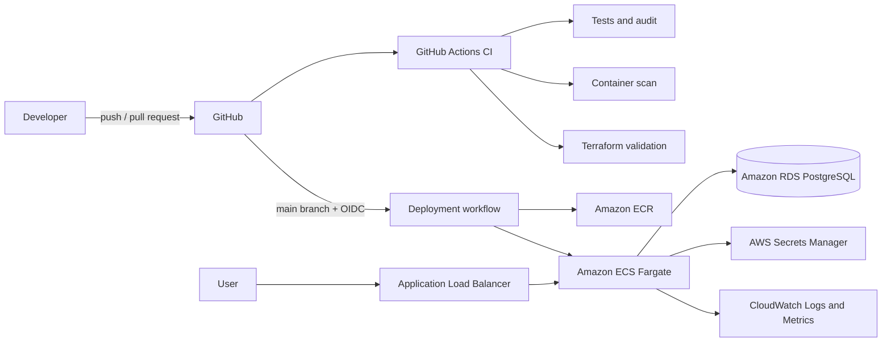

# Ethos

Ethos is a cloud-native release operations dashboard and an end-to-end DevOps portfolio project. It gives engineering teams one place to record deployments, track release outcomes, and monitor delivery health across development, staging, and production.

The application is intentionally small enough to understand in an interview. The platform around it demonstrates the larger skill set expected in DevOps, cloud, platform, and junior SRE roles: containers, CI/CD, Infrastructure as Code, cloud networking, secrets, observability, security scanning, deployment health checks, and rollback operations.

## Project status

| Capability | Status |
| --- | --- |
| Express API and operational dashboard | Implemented |
| PostgreSQL persistence and automatic schema migration | Implemented |
| Unit/API tests and coverage | Implemented |
| Docker image and Docker Compose environment | Implemented |
| Prometheus metrics and provisioned Grafana dashboard | Implemented |
| GitHub Actions CI, image scanning, and Terraform validation | Implemented |
| AWS Terraform for ECR, ECS, ALB, RDS, IAM, Secrets Manager, and CloudWatch | Implemented |
| GitHub OIDC deployment workflow | Implemented; requires an AWS account and GitHub setup |

## Architecture



Local development uses the same application image with PostgreSQL, Prometheus, and Grafana:

```text
Browser -> Ethos :3000 -> PostgreSQL :5432
                 |
                 +-> /metrics <- Prometheus :9090 <- Grafana :3001
```

## What the project demonstrates

- A multi-stage, non-root Docker image with a read-only cloud filesystem
- Reproducible local infrastructure through Docker Compose
- Liveness and database-aware readiness probes
- Graceful shutdown for safe rolling deployments
- Structured JSON request logs and request correlation IDs
- Prometheus request, latency, runtime, and release metrics
- A pre-provisioned Grafana operations dashboard
- Pull-request tests, dependency auditing, container scanning, and Terraform validation
- Immutable image tags based on the Git commit SHA
- Passwordless GitHub-to-AWS authentication through OIDC
- Infrastructure provisioned with Terraform
- Least-privilege network access between ALB, ECS, and RDS
- Runtime secret injection from AWS Secrets Manager
- CloudWatch alarms, encrypted RDS storage, backups, and ECR lifecycle policies
- A documented incident response and rollback procedure

## Technology stack

| Area | Technology |
| --- | --- |
| Runtime | Node.js 22, Express 5 |
| Frontend | Accessible HTML, CSS, and browser JavaScript |
| Database | PostgreSQL 16 locally, Amazon RDS in AWS |
| Tests | Node.js built-in test runner |
| Containers | Docker, Docker Compose |
| Metrics | Prometheus client, Prometheus, Grafana |
| CI/CD | GitHub Actions |
| Security | npm audit, Trivy, Dependabot, IAM, Secrets Manager |
| Cloud | AWS ECR, ECS Fargate, ALB, RDS, CloudWatch |
| Infrastructure | Terraform |

## Repository structure

```text
ethos/
|-- .github/
|   |-- dependabot.yml
|   `-- workflows/
|       |-- ci.yml
|       `-- deploy.yml
|-- docs/
|   `-- runbook.md
|-- infra/terraform/
|   |-- compute.tf
|   |-- database.tf
|   |-- github.tf
|   |-- network.tf
|   |-- observability.tf
|   `-- ...
|-- monitoring/
|   |-- grafana/
|   `-- prometheus.yml
|-- public/
|   |-- app.js
|   |-- index.html
|   `-- styles.css
|-- src/
|   |-- app.js
|   |-- config.js
|   |-- db.js
|   |-- metrics.js
|   |-- server.js
|   `-- validation.js
|-- test/
|-- compose.yaml
|-- Dockerfile
`-- README.md
```

## Run locally with Docker

### Prerequisites

- Docker Desktop with the Docker engine running
- Docker Compose v2 or newer

Start the complete stack:

```bash
docker compose up --build -d
```

Open the services:

| Service | URL | Credentials |
| --- | --- | --- |
| Ethos | <http://localhost:3000> | None |
| Grafana | <http://localhost:3001> | `admin` / `admin` |
| Prometheus | <http://localhost:9090> | None |

Check service state and logs:

```bash
docker compose ps
docker compose logs -f app
```

Stop the stack without deleting data:

```bash
docker compose down
```

Delete local volumes when a completely fresh environment is needed:

```bash
docker compose down --volumes
```

The Compose credentials are deliberately local-only. Never reuse them in a shared or public environment.

## Run without Docker

Install Node.js 22 and make PostgreSQL available, then create the local environment file:

```bash
cp .env.example .env
npm ci
npm run dev
```

On PowerShell, use:

```powershell
Copy-Item .env.example .env
npm.cmd ci
npm.cmd run dev
```

The application creates its table and indexes on startup. No separate migration command is required for this version.

## API

| Method | Path | Purpose |
| --- | --- | --- |
| `GET` | `/health` | Process liveness and deployed version |
| `GET` | `/ready` | Readiness, including PostgreSQL connectivity |
| `GET` | `/metrics` | Prometheus metrics |
| `GET` | `/api/releases?limit=50` | Recent deployments |
| `POST` | `/api/releases` | Create a deployment record |
| `PATCH` | `/api/releases/:id/status` | Change release status |
| `GET` | `/api/stats` | 30-day dashboard totals |

Create a release from a terminal:

```bash
curl -X POST http://localhost:3000/api/releases \
  -H "Content-Type: application/json" \
  -d '{
    "service": "payments-api",
    "version": "v1.4.2",
    "environment": "production",
    "status": "succeeded",
    "commitSha": "a1b2c3d",
    "owner": "platform-team",
    "notes": "Canary completed without errors"
  }'
```

Valid environments are `development`, `staging`, and `production`. Valid statuses are `queued`, `deploying`, `succeeded`, `failed`, and `rolled_back`.

## Tests and local checks

```bash
npm ci
npm run check
npm run test:coverage
npm audit --audit-level=high
docker compose config --quiet
```

Tests use an injected database adapter, so API behavior can be verified without a running PostgreSQL instance. Docker Compose provides the integration environment.

## Observability

Ethos exposes metrics at `/metrics`, including:

- `ethos_http_request_duration_seconds`
- `ethos_releases_created_total`
- Node.js process, memory, event-loop, and garbage-collection metrics

Grafana automatically loads the Prometheus data source and the **Ethos Overview** dashboard. It shows request rate, p95 latency, HTTP status rate, and created releases by environment and status.

In AWS, application logs are written to `/ecs/ethos-production`. ECS Container Insights is enabled, and Terraform creates alarms for high service CPU and repeated load-balancer `5xx` responses.

## CI pipeline

The [CI workflow](.github/workflows/ci.yml) runs on pull requests and pushes to `main`.

```text
Checkout
   |-- npm ci -> syntax check -> tests with coverage -> dependency audit
   |-- Docker Buildx -> build image -> Trivy high/critical scan
   `-- terraform fmt -> terraform init -> terraform validate
```

The workflow uses dependency caching and Docker layer caching. Concurrent runs for the same branch are canceled when a newer commit arrives.

Dependabot checks npm packages, Docker base images, GitHub Actions, and Terraform providers weekly.

## AWS infrastructure

Terraform creates:

- One VPC across two Availability Zones
- Two public subnets and an internet gateway
- A public Application Load Balancer
- An ECS Fargate cluster, task definition, and service
- An ECR repository with immutable tags, scanning, and image retention
- A private RDS PostgreSQL instance with encrypted storage and backups
- A Secrets Manager secret containing the database URL
- Separate ALB, application, and database security groups
- CloudWatch logs, Container Insights, and alarms
- ECS task and execution IAM roles
- A GitHub Actions deployment role and optional GitHub OIDC provider

For this learning project, Fargate tasks use public IPs so they can pull images and send logs without paying for a NAT Gateway. Their security group accepts application traffic only from the ALB. A stricter production design would place tasks in private subnets and use NAT or VPC endpoints.

## Deploy to AWS

AWS resources incur charges. Review the AWS Pricing Calculator and configure a billing budget before applying Terraform. RDS and the Application Load Balancer are typically the main always-on costs in this design.

### 1. Create the GitHub repository

Create a new repository named `ethos`, initialize Git in this directory, and push the code to `main`.

```bash
git init
git add .
git commit -m "Build Ethos cloud-native release platform"
git branch -M main
git remote add origin https://github.com/YOUR_GITHUB_USERNAME/ethos.git
git push -u origin main
```

The deployment job remains skipped until `AWS_DEPLOY_ENABLED` is explicitly enabled.

### 2. Protect Terraform state

Terraform state contains sensitive generated values. For a cloud deployment, create a private, versioned S3 bucket, rename `backend.tf.example` to `backend.tf`, and replace its placeholders before running `terraform init`. Do not commit state files.

### 3. Configure Terraform

```bash
cd infra/terraform
cp terraform.tfvars.example terraform.tfvars
```

Set `github_repository` to `YOUR_GITHUB_USERNAME/ethos`.

An AWS account can contain only one IAM OIDC provider for the GitHub URL. If one already exists, set:

```hcl
create_github_oidc_provider = false
github_oidc_provider_arn    = "arn:aws:iam::ACCOUNT_ID:oidc-provider/token.actions.githubusercontent.com"
```

GitHub repositories using immutable OIDC subject claims must also set `github_oidc_subjects` to the exact subject for the `production` environment. The example tfvars file shows the format.

### 4. Provision AWS

Authenticate the AWS CLI with an account authorized to create the documented resources:

```bash
terraform init
terraform fmt -check -recursive
terraform validate
terraform plan -out=ethos.tfplan
terraform apply ethos.tfplan
```

The initial ECS service intentionally has zero running tasks because the immutable ECR repository does not contain an application image yet.

### 5. Configure GitHub

Create a GitHub environment named `production` and restrict it to the `main` branch. Add an approval rule if the repository plan supports it.

Add these repository settings:

| Type | Name | Value |
| --- | --- | --- |
| Environment secret | `AWS_DEPLOY_ROLE_ARN` | Terraform output `github_deploy_role_arn` |
| Repository variable | `AWS_REGION` | The Terraform region, such as `us-east-1` |
| Repository variable | `AWS_DEPLOY_ENABLED` | `true` |

No AWS access key or secret access key is stored in GitHub.

### 6. Run the first deployment

Open **Actions -> Deploy to AWS -> Run workflow**. The workflow will:

1. Exchange GitHub's OIDC token for temporary AWS credentials.
2. Build the Docker image.
3. Tag the image with the immutable commit SHA.
4. Push it to ECR.
5. Create a new ECS task-definition revision.
6. Roll the ECS service to that revision.
7. Activate one task on the first deployment and wait for service stability.

Get the public URL:

```bash
terraform output -raw application_url
```

Later pushes to `main` automatically repeat the deployment after CI succeeds independently. For stricter sequencing, change the deploy trigger to `workflow_run` or make deployment a reusable workflow called only after CI succeeds.

## Rollback

Every deployment registers a new ECS task-definition revision, and older immutable images remain in ECR until the lifecycle policy removes them. Roll back by pointing the ECS service at the previous healthy revision.

See [docs/runbook.md](docs/runbook.md) for the exact command and incident checks.

## Security decisions

- The container runs as the built-in unprivileged `node` user.
- The ECS root filesystem is read-only.
- PostgreSQL is not publicly accessible.
- Security groups permit only ALB-to-app and app-to-database paths.
- The database URL comes from Secrets Manager at task startup.
- GitHub receives short-lived AWS credentials through OIDC.
- The OIDC trust is restricted to this repository's `production` environment subject.
- The deploy role can push only to the Ethos ECR repository and pass only the Ethos task roles.
- CI fails on known high or critical image vulnerabilities with fixes available.

Before treating this as a real production service, add authentication and authorization, HTTPS with ACM, AWS WAF, secret rotation, private ECS subnets, alarm notifications, database migration versioning, and a tested disaster-recovery policy.

## Cost controls

- The RDS instance defaults to a small Graviton class.
- RDS storage starts at 20 GiB and can autoscale to 50 GiB.
- Multi-AZ is disabled for this portfolio environment.
- ECR retains only the 20 most recent images.
- CloudWatch logs are retained for 30 days.
- Fargate starts at one task after the first deployment.
- No NAT Gateway is created.

Destroy the learning environment when it is not needed:

```bash
terraform destroy
```

This permanently deletes the database because the portfolio defaults use `skip_final_snapshot = true`. Export anything important before destroying it.

## Engineering tradeoffs

| Decision | Reason | Production evolution |
| --- | --- | --- |
| Express serves API and static UI | One deployable unit keeps the project focused on platform work | Separate frontend CDN and API services |
| Startup migration | Simple and safe for one idempotent schema | Versioned migrations in a release job |
| Public Fargate subnets | Avoids NAT cost while SGs still restrict ingress | Private subnets plus VPC endpoints |
| HTTP load balancer | Avoids requiring a domain during learning | ACM certificate and HTTPS redirect |
| One production task | Controls portfolio cost | Two or more tasks across AZs with autoscaling |
| Terraform creates DB credentials | Reproducible bootstrap | Managed rotation and external secret lifecycle |

## Interview talking points

Be prepared to explain:

1. Why `/health` and `/ready` answer different questions.
2. How an ALB health check prevents traffic from reaching a task before PostgreSQL is reachable.
3. Why Git SHA image tags make deployments and rollbacks traceable.
4. How GitHub OIDC removes long-lived AWS credentials from CI/CD.
5. Why the ECS task role and task execution role are separate.
6. How security groups restrict traffic between infrastructure layers.
7. What Prometheus histograms provide that average latency does not.
8. Why Terraform state is sensitive and belongs in an encrypted remote backend.
9. Which cost and availability tradeoffs were made for a portfolio environment.
10. How you would evolve the design for high availability and zero-downtime schema changes.

## Resume bullets

- Built and containerized a Node.js release-operations platform with PostgreSQL, health probes, graceful shutdown, structured logs, and Prometheus metrics.
- Implemented GitHub Actions CI/CD with automated tests, dependency auditing, Trivy image scanning, immutable ECR images, and rolling ECS Fargate deployments.
- Provisioned AWS networking, ALB, ECS, RDS, ECR, Secrets Manager, IAM, and CloudWatch through modular Terraform configuration.
- Secured AWS deployments using GitHub OIDC and least-privilege IAM, eliminating long-lived cloud credentials from CI/CD.
- Created local and cloud observability using Prometheus, Grafana, CloudWatch logs, Container Insights, health checks, and operational alarms.

## Roadmap

- Add user authentication and role-based access control
- Add service catalog and deployment webhooks
- Add deployment frequency, lead time, change failure rate, and recovery time metrics
- Add integration tests against PostgreSQL in CI
- Add HTTPS, Route 53, and AWS WAF
- Add ECS autoscaling and a second task for high availability
- Add OpenTelemetry traces and trace-to-log correlation
- Add blue/green deployments with AWS CodeDeploy
- Add preview environments for pull requests

## License

MIT
